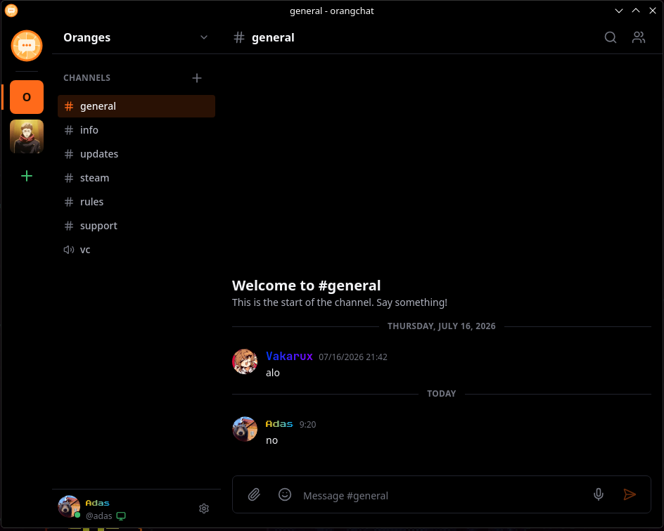

**OrangChat** is a real-time messaging client designed for private communities, server channels, and low-latency team communication.

## Features

- **Organized Channels & Guilds**: Category-based text channels, announcements, and direct messaging (DMs).
- **Rich Media & Markdown**: Embedded link previews, code syntax highlighting, custom emojis, and file attachments.
- **Low-Latency Voice & Video**: Crystal clear voice rooms with push-to-talk, noise suppression, and screen sharing.
- **Self-Hostable Backend**: Connect to public servers or host your own private community node.
- **Deep Desktop Integration**: System tray alerts, unread badges, custom themes, and `orangchat://` protocol URL handling.



## Installation & Launch

Run the client executable:

```bash
orangchat
```

Application desktop entry:
- **Binary**: `/usr/bin/orangchat`
- **Protocol**: `orangchat://`
- **Config & Cache**: `~/.config/@orangchat/`