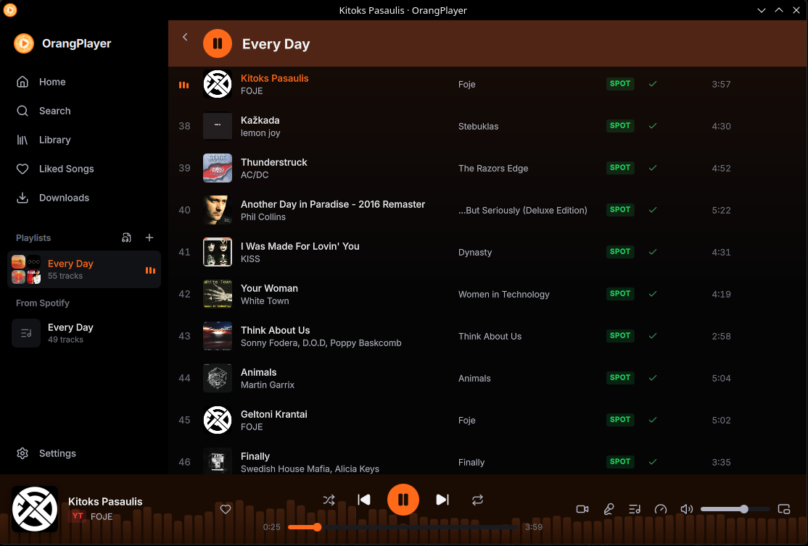

**OrangPlayer** is a feature-rich, high-performance multimedia player designed for local audio playback and online streaming across YouTube, YouTube Music, SoundCloud, and Spotify.

## Features

- **Multi-Source Playback**: Play local files (MP3, FLAC, WAV, OGG, AAC, OPUS, M4A) or stream directly from online providers.
- **Classic & Modern Skinning**: Full support for classic WinAMP (`.wsz`), Windows Media Player skins, and a native Dark/AMOLED UI.
- **Integrated Audio Visualizers**: Spectral visualizers, waveform views, and customizable frequency meters.
- **Graphic Equalizer**: 10-band precision equalizer with bass boost, reverb presets, and customizable sound profiles.
- **Smart Queue & Playlist Management**: Import/export M3U, M3U8, PLS, and seamless track queuing.
- **System Tray & Media Keys Support**: Complete MPRIS integration on Linux and media hotkey bindings.




## Installation

### Linux

OrangPlayer is distributed as an executable package and installed under `/usr/bin/orangplayer`:

```bash
sudo curl -sSL https://raw.githubusercontent.com/Orang-Studio/OrangPlayer/main/install.sh | bash
```

Launch from terminal:

```bash
orangplayer
```

Or open from your desktop application launcher under **Sound & Video**.

## Configuration

Settings and saved visualizer themes are stored in `~/.config/orangplayer/settings.json`:

```json
{
  "theme": "amoled",
  "volume": 85,
  "equalizer_enabled": true,
  "visualizer": "spectral_bars",
  "auto_scrobble": false
}
```