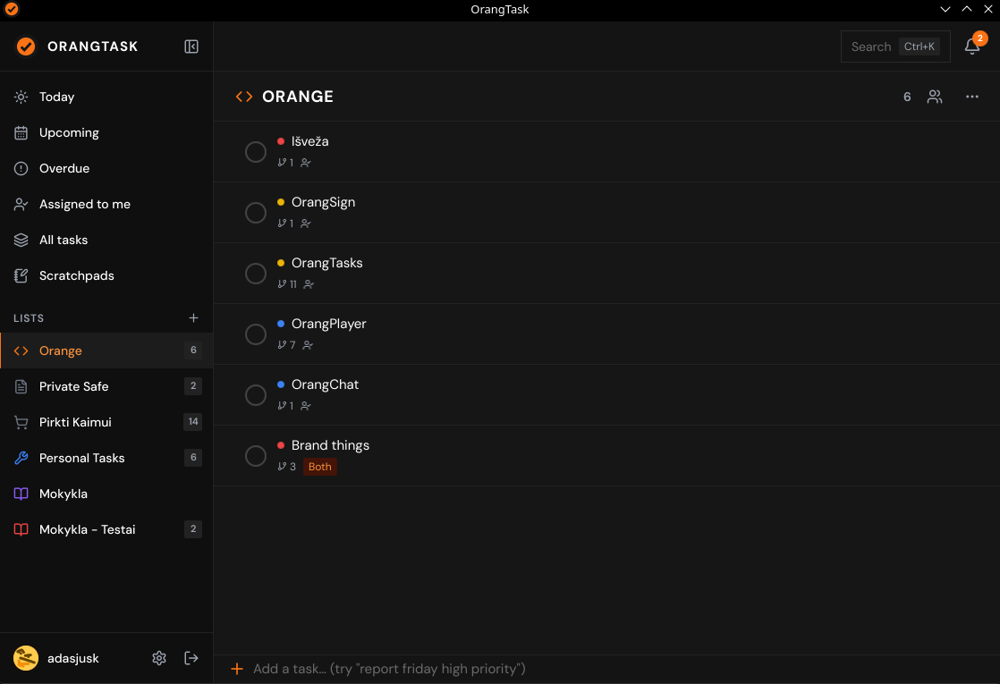

**OrangTask** is a desktop task manager and personal checklist application.

## Features

- **System Tray Quick Access**: Click the tray icon or use desktop shortcuts to view, toggle, and add tasks without interrupting your flow.
- **Sticky Note Scratchpad**: Pin floating scratchpads to your desktop for quick meeting notes, scratch code, or temporary snippets.
- **Reminders & System Notifications**: Scheduled alerts, repeating tasks, and sound notifications for upcoming deadlines.
- **Task Lists & Filters**: Organize tasks into categorized lists, priorities, and completed archives.
- **Cloud Account Sync**: Optional synchronization across devices with your `oranges.lt` user account.

Check it at here: [OrangTasks](https://task.oranges.lt)
to install it, you can do that from [Github](https://github.com/Orang-Studio/OrangTask/releases)
or [Google Play Store](https://play.google.com/store/apps/details?id=lt.oranges.orangtask)

## Desktop Actions & Commands

| Action            | Command                 | Description                                       |
| :---------------- | :---------------------- | :------------------------------------------------ |
| **Launch / Tray** | `orangtask`             | Starts OrangTask in the background / system tray. |
| **Quick Add**     | `orangtask --quick-add` | Opens an immediate single-line task input dialog. |
| **Show Popup**    | `orangtask --popup`     | Triggers the quick-view checklist popover.        |
| **Toggle Sticky** | `orangtask --sticky`    | Toggles the desktop sticky note scratchpad.       |

Config location: `~/.config/OrangTask/orangtask.ini`